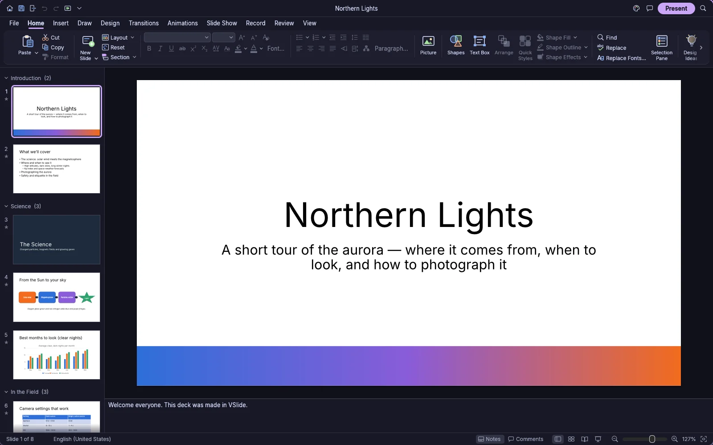

<p align="center"></p>

# VSlide

VSlide is the presentations app of [Vyntaris Office](https://vyntarisos.com/), the office suite of
the Vyntaris desktop. It opens, edits, presents and saves PowerPoint files (`.pptx`, `.potx`,
`.ppsx`, and the older `.ppt`) and its own `.vslide` files.

It is a fork of [DeckCraft](https://github.com/storytold/deckcraft) by the ArtCraft Team. The slide
engine, the PowerPoint reader and writer and most of the interface are DeckCraft's; this repository
adds what Vyntaris needs and keeps up with DeckCraft's changes.



## Install

On Vyntaris it is optional: the `vslide` package from the `[vyntaris]` repository.

```sh
sudo pacman -S vslide        # or vyntaris-office for VDoc, VSheet and VSlide together
```

Updates come with the rest of the system (`sudo pacman -Syu`). VSlide never updates itself.

## What Vyntaris changes

- **The desktop's theme.** VSlide wears the GTK theme the Vyntaris shell writes (flavour and accent)
  and restyles itself when it changes. Preferences › *Follow the desktop's theme* turns that off for a
  fixed light or dark look. Icons use the Catppuccin accents of the theme (Latte or Mocha).
- **Password-protected PowerPoint files.** Opening one asks for its password; saving it as PowerPoint
  encrypts it again with the same password (agile encryption, as Office 2010+). Such a file never
  goes into AutoRecover, where it would sit unencrypted. The code is `shared/office-crypt`, written
  from Microsoft's open [MS-OFFCRYPTO] specification.
- **PowerPoint first.** Save and Save As suggest `.pptx`. A `.ppt`, `.pps` or `.pot` name is saved as
  `.pptx`, `.ppsx` or `.potx` next to it, since VSlide can't write the 97–2003 format.
- **Wayland.** It runs as a native Wayland window at the desktop's scale. `VSLIDE_X11=1` starts it
  through XWayland instead.
- **Its own identity.** App id `org.vyntaris.VSlide`, its own icon and desktop entry
  (`packaging/linux/`), links to this repository instead of DeckCraft's site.
- **Older files.** `.vslide` files saved by earlier Vyntaris Office builds still open.

Everything else (editing, slide shows, presenter view, export to PDF, pictures, GIF and video) works
as in DeckCraft.

## Files

| What | Where |
|---|---|
| Settings (`ui.json`, `prefs.json`) | `~/.config/vslide/` |
| Log (attach it to a bug report) | `~/.config/vslide/logs/vslide.log` |
| AutoRecover copies | `~/.local/share/vslide/recovery/` |

## Build

Rust 1.95 or newer:

```sh
cargo run --release -p vslide            # the app
cargo run --release -p vslide -- deck.pptx
cargo test -p vslide-engine -p vslide-ui-egui
```

The Vyntaris package builds `cargo build --release --locked -p vslide` and installs the binary,
`packaging/linux/org.vyntaris.VSlide.{desktop,metainfo.xml}` and the icons from
`assets/app-icon/hicolor/*/apps/org.vyntaris.VSlide.*`.

## Branches

- `vyntaris` (default): VSlide.
- `upstream`: DeckCraft's history with its name replaced by VSlide. New DeckCraft releases are
  brought in by merging it into `vyntaris`.
- `main`: DeckCraft as it is, kept for reference.

## Licence

MIT OR Apache-2.0, as DeckCraft (`LICENSE-MIT`, `LICENSE-APACHE`). `NOTICE` names what comes from
DeckCraft and craft-libs and what Vyntaris added. VSlide doesn't use the ArtCraft name or logos.

Bugs: [github.com/vyntaris/vslide/issues](https://github.com/vyntaris/vslide/issues).

[MS-OFFCRYPTO]: https://learn.microsoft.com/en-us/openspecs/office_file_formats/ms-offcrypto/
